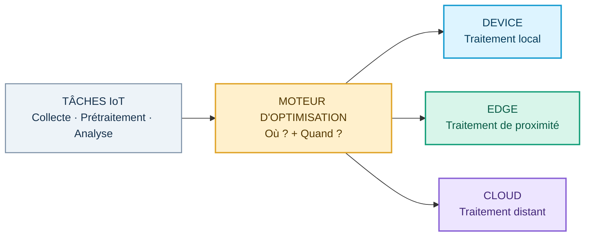
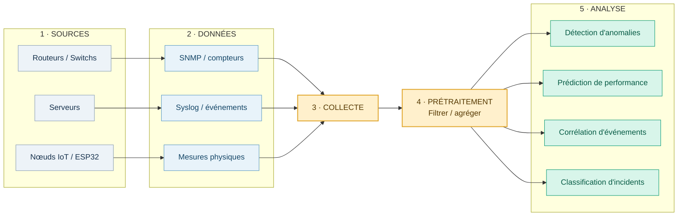
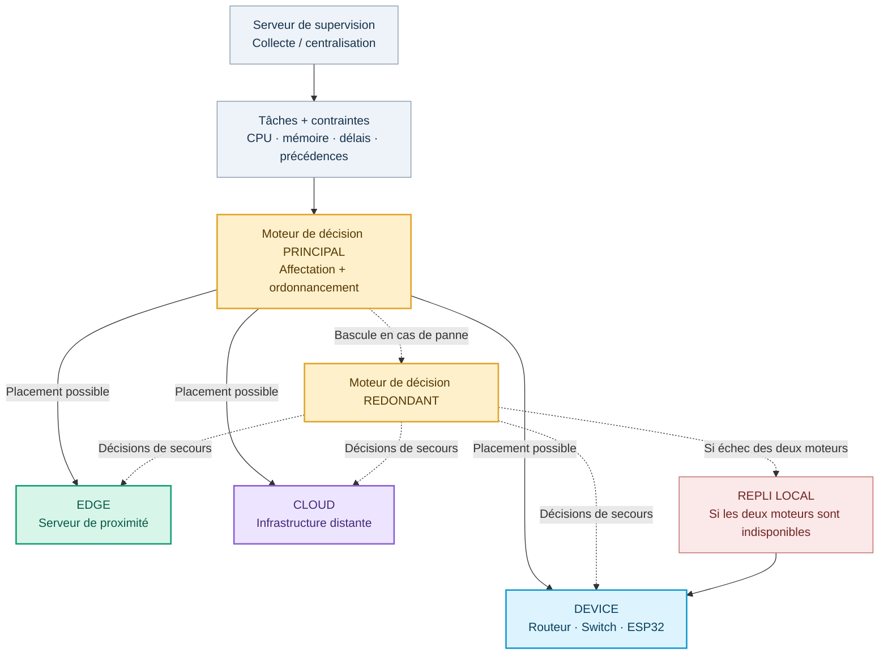
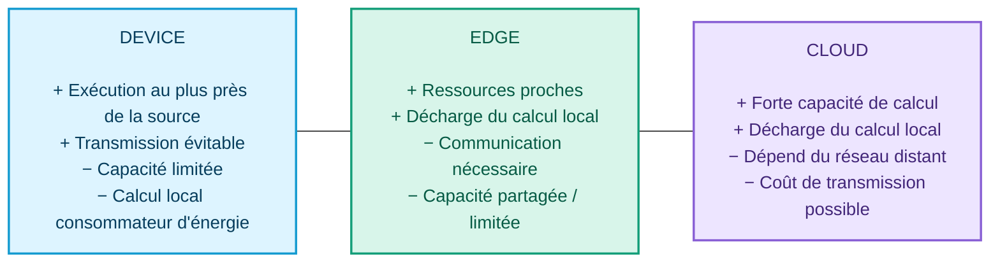
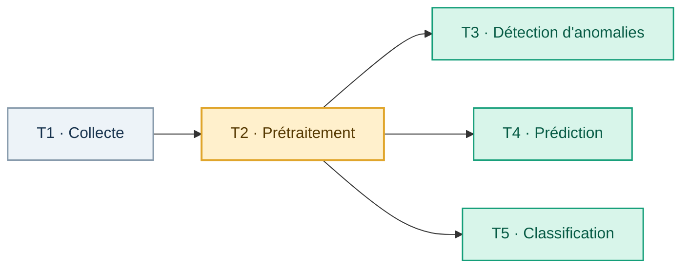

# Présentation RO — Contenu définitif des 6 premières slides

**Projet :** Optimisation multicritère de la collecte et du traitement de données IoT en environnement Edge par affectation et ordonnancement de tâches  
**Statut :** Proposition / modèle conceptuel (pas de résultats expérimentaux présentés ici).  
**Usage :** Document prêt à transmettre au designer. Copier **uniquement** les blocs « Texte à afficher » sur les diapositives. Les blocs Mermaid sont les schémas à reproduire (ou à exporter en SVG). Les consignes visuelles ne doivent pas apparaître à l'écran.

> **Périmètre strict :** remplacer le contenu des **slides 1 à 6 uniquement**. Ne pas modifier les diapositives de **benchmark**, d'**état de l'art** ou les contenus des autres membres du groupe. Ne pas ajouter de chiffres, de résultats calculés, de gains estimés ou de graphiques quantitatifs non mesurés.

## Charte visuelle commune (pour le designer — ne pas afficher)

- **Format :** 16:9, fond clair ou bleu nuit sobre, beaucoup d'espace autour du schéma.
- **Correspondance des couleurs à garder sur les six slides :** **Device = cyan / bleu**, **Edge = vert / turquoise**, **Cloud = violet** ; **décision / optimisation = ambre**.
- **Hiérarchie :** titre fort → une phrase qui explique le problème → un schéma central → une conclusion d'une ligne.
- **Règle scientifique :** les flèches représentent des relations logiques, flux possibles ou décisions, **pas** des mesures de performance. Les graphes d'exemple sont signalés comme « illustratifs ».
- **Lisibilité :** privilégier les libellés courts dans les diagrammes ; placer les précisions scientifiques à côté du schéma, et non dans les nœuds.

---

# SLIDE 1 — TITRE / PROMESSE DU PROJET

## Texte à afficher — copier tel quel

**OPTIMISATION MULTICRITÈRE DES TÂCHES IoT**

**Affectation et ordonnancement dans une architecture Device–Edge–Cloud**

*Projet de Recherche Opérationnelle*

**Question directrice :** Où et quand exécuter chaque tâche pour concilier latence, énergie et coût de communication ?

**[Noms des membres du groupe] — [Date de présentation]**

## Schéma principal — Mermaid

## Consigne de mise en page — ne pas afficher

Placer le titre sur la moitié gauche, puis le schéma à droite. Le moteur d'optimisation doit être le point focal. Les trois niveaux doivent être visuellement de même importance : **aucun n'est annoncé gagnant**.

---

# SLIDE 2 — CONTEXTE : D'OÙ VIENNENT LES TÂCHES ?

## Texte à afficher — copier tel quel

**Des données hétérogènes à transformer en décisions**

Les équipements connectés produisent en continu des données de supervision. Leur exploitation forme une chaîne de traitements qui peut être répartie entre plusieurs niveaux de calcul.

**Sources :** routeurs, commutateurs, serveurs et nœuds IoT (ex. ESP32).

**Données :** compteurs SNMP, journaux Syslog, mesures physiques et métriques de trafic.

**Traitements :** collecte → prétraitement → analyse.

**Enjeu :** déplacer les calculs peut accélérer certains traitements, mais implique des transferts et une consommation d'énergie à prendre en compte.

## Schéma principal — Mermaid

## Consigne de mise en page — ne pas afficher

Le **pipeline doit dominer la slide** : sources à gauche, étapes de traitement au centre, quatre tâches d'analyse à droite. Ajouter éventuellement trois petites étiquettes « volume », « calcul » et « délai », **sans valeurs**. Garder la phrase « Enjeu » comme bandeau de bas de page.

**Note de rigueur :** le diagramme montre le chemin fonctionnel des données, **pas** une obligation d'exécuter toutes les étapes sur le même nœud. Le prétraitement sur l'équipement est une option du projet.

---

# SLIDE 3 — ARCHITECTURE : COMMENT LE SYSTÈME PREND LA DÉCISION ?

## Texte à afficher — copier tel quel

**Une décision centralisée, une exécution distribuée**

Un moteur de décision choisit le niveau d'exécution de chaque tâche et organise son exécution en fonction de ses caractéristiques et des ressources disponibles.

**Device :** traitement sur l'équipement producteur.  
**Edge :** traitement sur des serveurs proches.  
**Cloud :** traitement sur des ressources distantes.

**Continuité prévue :** moteur redondant ; si les deux moteurs sont indisponibles, repli vers une exécution locale sur l'équipement.

## Schéma principal — Mermaid

## Consigne de mise en page — ne pas afficher

Reproduire en **trois zones horizontales** : (1) supervision et paramètres en haut ; (2) moteurs principal / secours au milieu ; (3) trois niveaux Device–Edge–Cloud en bas. Le repli local doit être **une annotation de continuité**, pas un quatrième niveau de calcul. Utiliser des traits pleins pour le placement normal et pointillés pour les scénarios de panne.

**Note de rigueur :** le schéma représente l'architecture proposée, pas un déploiement validé. Les équipements Edge/Cloud peuvent être multiples ; les trois blocs représentent des catégories de nœuds.

---

# SLIDE 4 — POURQUOI L'AFFECTATION EST DIFFICILE ?

## Texte à afficher — copier tel quel

**Trois niveaux, des compromis différents**

| Critère | DEVICE | EDGE | CLOUD |
|:--|:--|:--|:--|
| Capacité de calcul | Limitée | Intermédiaire | Élevée |
| Distance de traitement | Sur l'équipement | À proximité | À distance |
| Latence de communication | Nulle pour un calcul purement local | Généralement faible | Potentiellement plus élevée |
| Calcul demandé à l'équipement | Plus important | Réduit | Réduit |
| Données à transmettre | Évitables si traitement local | Dépendent du prétraitement et du placement | Dépendent du prétraitement et du placement |

**Conclusion :** aucun niveau ne minimise systématiquement la latence, l'énergie de l'équipement et le coût de transmission pour toutes les tâches.

## Visuel principal — cartes qualitatives Mermaid

## Consigne de mise en page — ne pas afficher

**Ne pas utiliser de radar ni d'histogramme chiffré** : aucun score mesuré n'existe à ce stade. Pour un rendu moins « tableau académique », préférer **trois cartes comparatives** (Device, Edge, Cloud) accompagnées de petits pictogrammes calcul / réseau / énergie, puis une conclusion commune. Le tableau ci-dessus fournit le texte exact des comparaisons.

**Attention scientifique :** ne pas écrire « l'Edge ou le Cloud consomme toujours moins d'énergie ». Le calcul local baisse, mais le coût énergétique de la transmission subsiste ; le résultat dépend de la tâche et de la quantité de données.

---

# SLIDE 5 — PROBLÈME DE RECHERCHE OPÉRATIONNELLE

## Texte à afficher — copier tel quel

**Deux décisions couplées : où et quand exécuter ?**

**1. AFFECTATION — Où ?** Choisir pour chaque tâche un nœud éligible : Device, Edge ou Cloud.

**2. ORDONNANCEMENT — Quand ?** Fixer l'ordre et le début d'exécution en respectant les précédences et les échéances.

**Trois objectifs à minimiser simultanément :**
- Latence des tâches (attente et exécution comprises)
- Énergie consommée par les équipements producteurs
- Coût de transmission des données

**Contraintes :** capacités CPU et mémoire, délais, précédences et éligibilité ; un équipement ne traite que ses propres tâches.

**Idée clé :** une bonne affectation peut devenir mauvaise si le nœud choisi est occupé au mauvais moment.

## Schéma principal A — Graphe de dépendances (EXEMPLE ILLUSTRATIF)

**Légende à afficher sous le graphe :** *Exemple illustratif de précédences : T3, T4 et T5 peuvent démarrer après T2, sous réserve de ressources disponibles.*

## Schéma principal B — Matrice d'affectation (EXEMPLE ILLUSTRATIF, NON OPTIMAL)

> Le designer peut reproduire cette matrice comme une petite **heatmap de sélection**. Une seule case active par ligne. **Ne pas afficher ce choix comme le résultat d'un algorithme.**

| Tâche illustrative | Device | Edge | Cloud |
|:--|:--:|:--:|:--:|
| T1 · Collecte | ● | – | – |
| T2 · Prétraitement | ● | – | – |
| T3 · Anomalies | – | ● | – |
| T4 · Prédiction | – | – | ● |
| T5 · Classification | – | ● | – |

**Légende à afficher :** *Une affectation possible, présentée uniquement pour expliquer les variables de décision.*

## Élément mathématique discret — à afficher en bas à droite

\[
x_{i,k}\in\{0,1\},\qquad \sum_{k\in N_i}x_{i,k}=1
\]

*Chaque tâche i est affectée à exactement un nœud éligible k.*

## Consigne de mise en page — ne pas afficher

Faire **deux panneaux côte à côte** : à gauche, le petit graphe des dépendances ; à droite, la matrice d'affectation (Device cyan, Edge vert, Cloud violet). Au-dessous, une flèche « ordonnancement » et la formule courte. Les objectifs et contraintes peuvent être regroupés dans deux bandes de texte compactes. **Ne pas fabriquer de diagramme de Gantt avec des dates ou durées prétendument mesurées**.

**Note de rigueur :** les flèches T2→T3/T4/T5 sont **un exemple de dépendances**, pas une contrainte universelle entre ces catégories d'analyse. L'ensemble \(N_i\) peut contenir plusieurs nœuds : Device, Edge et Cloud sont des **niveaux**, pas nécessairement trois machines uniques.

---

# SLIDE 6 — TROIS MODES DE DÉCISION

## Texte à afficher — copier tel quel

**Même problème, trois horizons d'information**

**HORS LIGNE**  
Toutes les tâches sont connues à l'avance. Le placement et l'ordonnancement peuvent être optimisés globalement.

**PAR LOTS**  
Les tâches arrivées pendant une fenêtre sont regroupées. Une nouvelle optimisation est lancée à chaque fenêtre.

**EN LIGNE**  
Chaque tâche est affectée à son arrivée, sans connaître les tâches futures. La décision doit être rapide.

**Question de comparaison :** comment la qualité des compromis évolue-t-elle quand l'information disponible et le temps de décision diminuent ?

## Schéma principal — Mermaid (trois bandes parallèles)

```mermaid
flowchart TB
    subgraph O["HORS LIGNE · vue globale"]
        direction LR
        O1["T1 + T2 + T3 + … + Tn<br/>Connues d'avance"] --> O2["Optimisation globale"] --> O3["Plan d'exécution"]
    end

    subgraph B["PAR LOTS · vue par fenêtres"]
        direction LR
        B1["Fenêtre 1<br/>Lot de tâches"] --> B2["Optimisation 1"] --> B3["Fenêtre 2<br/>Nouveau lot"] --> B4["Optimisation 2"]
    end

    subgraph L["EN LIGNE · vue immédiate"]
        direction LR
        L1["Arrivée T1"] --> L2["Décision T1"] --> L3["Arrivée T2"] --> L4["Décision T2"]
    end

    classDef task fill:#EDF3F8,stroke:#8DA0B4,color:#17324D;
    classDef decision fill:#FFF0CC,stroke:#E0A52B,color:#553800,stroke-width:1.7px;
    classDef outcome fill:#D8F5EA,stroke:#149E79,color:#075B45;
    class O1,B1,B3,L1,L3 task;
    class O2,B2,B4,L2,L4 decision;
    class O3 outcome;
```

## Tableau optionnel de composition (MÊME CONTENU, PAS UNE SLIDE SUPPLÉMENTAIRE)

| Mode | Information connue à la décision | Moment de la décision |
|:--|:--|:--|
| Hors ligne | Ensemble des tâches | Avant exécution |
| Par lots | Tâches de la fenêtre courante | À chaque fenêtre |
| En ligne | Tâche reçue et état courant | À chaque arrivée |

## Consigne de mise en page — ne pas afficher

Privilégier **trois frises horizontales** empilées plutôt qu'un tableau plein écran. Chaque frise a ses propres petits blocs « tâches » et « décision ». Faire ressortir la **différence d'information connue** ; ne pas suggérer qu'un mode est déjà meilleur, puisqu'aucun test comparatif n'est présenté.

---

# Contrôle final pour le designer (ne pas afficher)

- [ ] Les six premières slides forment l'histoire **sources de données → architecture → compromis → problème d'optimisation → modes de décision**.
- [ ] Les couleurs Device / Edge / Cloud restent identiques partout.
- [ ] Le slide 5 contient bien les **deux décisions** : affectation **et** ordonnancement.
- [ ] CPU et mémoire sont des **contraintes de capacité**, pas des objectifs supplémentaires.
- [ ] Le coût de transmission n'est pas confondu avec le volume transmis.
- [ ] Les schémas conceptuels et exemples ne sont jamais présentés comme des résultats mesurés.
- [ ] Aucune slide hors de 1 à 6 n'est réécrite ou retouchée.

## Correspondance avec les documents fournis (référence interne, ne pas afficher)

- **Proposition_Projet_RO.pdf** : problème central, pipeline, trois niveaux, deux décisions, trois objectifs, prétraitement local et trois modes.
- **Placement multicritère de tâches de supervision IoT.pptx** : scénario de supervision, routeurs/switchs/ESP32, moteur principal et redondant, repli local, structure initiale des six slides.
- **Cours 1. modélisation.pdf** : variables binaires, contraintes d'affectation, objectif et capacité ; formulation mathématique du choix discret.
- **Cours 2.pdf** : problèmes d'affectation / localisation et ordonnancement de tâches liées par précédences ; intérêt du graphe de dépendances.
