# Brief intégral pour le designer — Placement multicritère IoT / État de l’art

**Livrable : 14 diapositives, textes prêts à copier-coller, diagrammes Mermaid prêts à reproduire et instructions de disposition.**

**Périmètre définitif : placement / affectation multicritère des tâches de supervision IoT uniquement. Le projet ne traite pas leur ordonnancement. Aucune formule ni équation mathématique ne doit apparaître sur les slides.**

**Décision de périmètre mise à jour : deux types de tâches uniquement — COLLECTE et ANALYSE. Le flux fonctionnel est « Collecte → Analyse ». Le prétraitement n'est ni une troisième étape ni une catégorie de tâches autonome dans le projet.**

**Instruction au designer :** illustrer les niveaux Device–Edge–Cloud, les décisions de placement, les contraintes, les critères qualitatifs et les trois modes de décision par des organigrammes, cartes, matrices non chiffrées et frises conceptuelles. **Exclure les diagrammes de Gantt, les graphes de précédence, les calendriers d’exécution et toute notation symbolique.**

## HIÉRARCHIE DES SOURCES — PRIORITÉ ABSOLUE

1. **Source principale A :** `Placement multicritère de tâches de supervision IoT.pptx` → slides **1 à 7** du présent brief (les 7 slides du PPTX, dans le même ordre).
2. **Source principale B :** le second PPTX transmis (état de l’art IoT edge-cloud) → slides **8 à 14** du présent brief (les 7 slides du PPTX, dans le même ordre).
3. **Sources secondaires de compréhension, jamais de remplacement :** `Proposition_Projet_RO.pdf`, `Cours 1. modélisation.pdf`, `Cours 2.pdf`. Elles peuvent aider à comprendre un concept, **mais ne doivent pas ajouter, corriger ni remplacer une information des deux PPTX**.

**Règle de résolution des conflits : si le PDF et un PPTX donnent des objectifs, termes ou niveaux de détail différents, le contenu du PPTX prévaut.** Les schémas supplémentaires sont des représentations graphiques, et non des données expérimentales ou une reformulation scientifique.

## Règles de production — ne pas afficher

- Présentation 16:9 ; **14 slides** dans l’ordre indiqué. Le designer peut changer la disposition (table → cartes, bloc → frise, etc.) mais ne doit ni supprimer ni ajouter d’information présentée comme issue du projet.
- Les sections **« TEXTE À AFFICHER »** constituent le texte de référence à copier-coller. Les diagrammes Mermaid ne doivent pas obligatoirement apparaître en plus des textes : ils peuvent remplacer leur disposition visuelle, **à condition de préserver tous les libellés**.
- Garder les titres, noms d’auteurs, dates, nombres, qualificatifs, réserves, sigles, et éléments entre crochets tels qu’ils figurent dans les sources. Les éventuelles fautes de saisie des PPTX sont conservées pour ne pas modifier silencieusement le contenu ; correction typographique uniquement après validation de l’équipe.
- Utiliser, si souhaité : **Device = cyan**, **Edge = vert**, **Cloud = violet**, **décision = ambre**, **réserves = gris**. Ce code couleur est graphique, pas scientifique.
- **Aucun pourcentage, durée, consommation, résultat de test ou gain de performance inventé**. Les graphiques doivent être qualitatifs ou conceptuels, sauf chiffres déjà présents dans les PPTX.
- **Aucune formule mathématique** : pas de variables de décision en notation algébrique, d’équations, d’objectifs symboliques ou de contraintes écrites avec des signes mathématiques. Les noms des méthodes (MILP, ε-contrainte, NSGA-II, etc.) sont conservés car ce ne sont pas des formules.
- **Deux types de tâches, et seulement deux : collecte et analyse.** Le designer doit utiliser ce découpage dans les schémas métier, y compris quand il simplifie un pipeline. Il ne doit pas représenter de tâche indépendante de prétraitement.
- **Aucun traitement de l’ordonnancement** : ne pas représenter les heures de début/fin, la séquence des tâches, les dépendances de précédence ni les Gantt. Les trois modes « hors ligne / par lots / en ligne » décrivent uniquement **quand le placement est décidé**.
- Dans le **benchmark et l’état de l’art**, conserver les descriptions des articles, méthodes, chiffres, métriques et réserves issues des PPTX. Seule exception imposée par le nouveau périmètre : à la slide 14, la donnée projet « Mémoire et dépendances » devient **« Mémoire »** : les dépendances sont retirées de ce qui reste à construire. Les mentions historiques de *workflows DAG* dans un article restent des informations bibliographiques, sans engagement de les modéliser.
- Les **slides 7 à 14** (benchmark et état de l’art) conservent les informations des PPTX d’origine, **sauf le retrait ciblé de « et dépendances » en slide 14** lié au périmètre actualisé. Leurs schémas sont uniquement des choix de mise en page.
- Ne pas afficher au public les annotations « Consignes designer », « Vérification », ni les blocs de code Mermaid : afficher uniquement les diagrammes rendus et les textes destinés aux slides.

---

# SLIDE 1 — COUVERTURE

**Référence :** PPTX A, slide 1. **Aucun ajout de question centrale ou d’objectif ne doit remplacer le titre d’origine.**

## TEXTE À AFFICHER — COPIER TEL QUEL

**Recherche opérationnelle · Projet**

# Placement multicritère de tâches de supervision réseau et IoT dans une architecture Equipement-Edge-Cloud

**Device · Edge · Cloud**

[Noms du groupe] · [Date]

## SCHÉMA MERMAID — visuel de couverture (complément, pas du nouveau contenu)

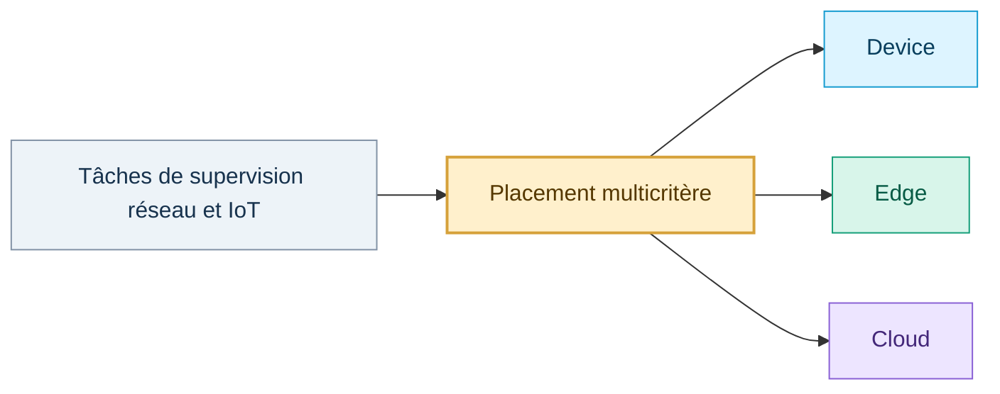

**Consignes designer — ne pas afficher :** Une vraie couverture : titre majoritaire à gauche, schéma en petite composition sur la droite. Garder les termes « Equipement-Edge-Cloud » du titre et « Device · Edge · Cloud » comme écrit dans le PPTX, sans les remplacer par un titre emprunté au PDF.

---

# SLIDE 2 — CONTEXTE : DES DONNÉES HÉTÉROGÈNES À EXPLOITER

**Référence :** PPTX A, slide 2.

## TEXTE À AFFICHER — COPIER TEL QUEL

**Contexte : des données hétérogènes à exploiter**

**Sources**
- Routeurs
- Commutateurs
- Serveurs
- Nœuds IoT ESP32 : MQ-6, DHT22*

**Données hétérogènes**
- Compteurs SNMP (MIB)
- Mesures physiques (agents SNMP ESP32)
- Journaux opérationnels

**Deux types de tâches — Collecte → Analyse**

**Type 1 — Collecte**
- Collecte périodique

**Type 2 — Analyse**
- Analyse opérationnelle et statistique
- Classification des événements

**Où exécuter chacun de ces traitements : équipement, Edge ou Cloud ?**

* sous réserve de confirmation

## SCHÉMA MERMAID — deux types de tâches, sans étape de prétraitement

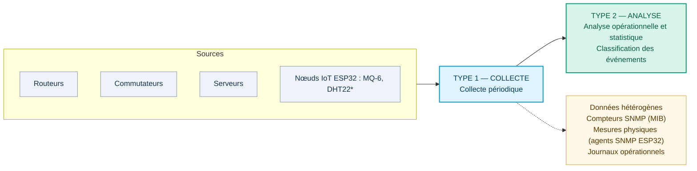

**Consignes designer — ne pas afficher :** Faire apparaître le flux principal **Sources → COLLECTE → ANALYSE**. La **collecte** et l'**analyse** sont les **deux types de tâches**, pas trois étapes. Placer « Données hétérogènes » comme légende encadrée ou vignette reliée à « Collecte », et non comme un troisième type de tâche. Conserver les trois libellés de données et les trois libellés d'exploitation de la slide d'origine, simplement reclassés entre collecte et analyse. La question finale occupe une bande distincte en bas. La réserve `* sous réserve de confirmation` reste associée aux capteurs ESP32.

---

# SLIDE 3 — ARCHITECTURE ET REDONDANCE

**Référence :** PPTX A, slide 3.

## TEXTE À AFFICHER — COPIER TEL QUEL

**Architecture : un moteur de décision choisit le niveau d'exécution**

**Moteur de décision principal**

**bascule**

**Moteur de décision redondant**

**Serveur de supervision : collecte et centralisation des données**

**Device**
- Routeurs, switchs, ESP32

**Edge**
- Serveurs proches

**Cloud**
- Ressources distantes

**Repli : si les deux moteurs sont indisponibles, exécution locale sur l'équipement**

## SCHÉMA MERMAID — architecture (flux fonctionnel illustratif)

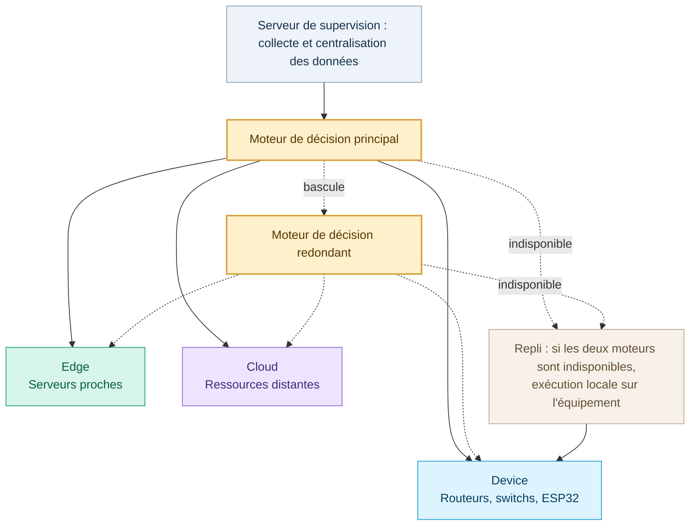

**Consignes designer — ne pas afficher :** Mettre le **serveur de supervision** en amont, les **deux moteurs de décision** au milieu, les **trois niveaux d’exécution** en bas. Flèche pointillée « bascule » entre moteurs. Isoler la mention de repli dans un bandeau de pied. **Ne présenter aucun composant de planification des tâches** : le moteur décide du niveau d’exécution, pas de leur ordre.

---

# SLIDE 4 — COMPARAISON DEVICE / EDGE / CLOUD

**Référence :** PPTX A, slide 4.

## TEXTE À AFFICHER — COPIER TEL QUEL

**Trois niveaux d'exécution, trois profils**

| | Device | Edge | Cloud |
|---|---|---|---|
| Puissance de calcul | Faible | Moyenne | Élevée |
| Latence | Très faible (pas de transfert) | Faible | Élevée |
| Énergie de l'équipement | Forte | Faible | Faible |
| Volume de données transmis | Nul | Moyen | Élevé |

**Aucun niveau n'est optimal pour toutes les tâches.**

*Tendances qualitatives. Device = routeur, switch ou ESP32 (capacités variables, ESP32 le plus limité).*

## SCHÉMA MERMAID — trois cartes, mêmes valeurs que dans le tableau

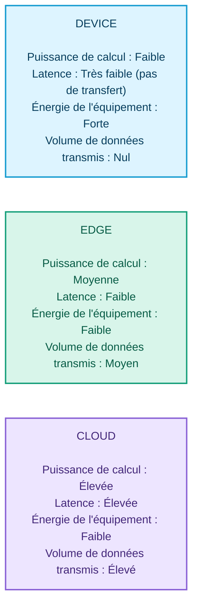

## AUTRE REPRÉSENTATION — matrice catégorielle (non chiffrée)

Reproduire la table initiale avec des **pastilles textuelles** « Faible / Moyenne / Élevée / Nul / Très faible ». Ne pas transformer ces catégories en pourcentages ou en scores inventés.

**Consignes designer — ne pas afficher :** Le tableau et le diagramme portent les mêmes valeurs : utiliser **l’un ou l’autre**, ou trois cartes + mini-table. Conserver le sous-titre « Tendances qualitatives... » exactement ; cela signale que ces valeurs ne sont pas des mesures vérifiées.

---

# SLIDE 5 — LE PROBLÈME : AFFECTER LES TÂCHES

**Référence :** PPTX A, slide 5. **Attention : garder les rubriques et les éléments d’origine, même s’ils sont présentés différemment dans le PDF.**

## TEXTE À AFFICHER — COPIER TEL QUEL

**Le problème : où exécuter chaque tâche ?**

**Décision**
- Niveau d'exécution de chaque tâche : Device, Edge ou Cloud

**Contraintes**
- Capacités CPU et mémoire
- 2. Capacités temporelles : fenetre glissante danalyse, periodicite de collecte, latence
- 3. Éligibilité : un device ne traite que ses propres tâches

**Objectifs à minimiser**
- Ressources de calcul : CPU et mémoire
- Latence des tâches
- Énergie des équipements consomee
- Volume de communication des données

**Objectifs en conflit : pas de solution unique, mais des compromis.**

## SCHÉMA MERMAID — décision, contraintes, objectifs (mêmes rubriques et libellés)

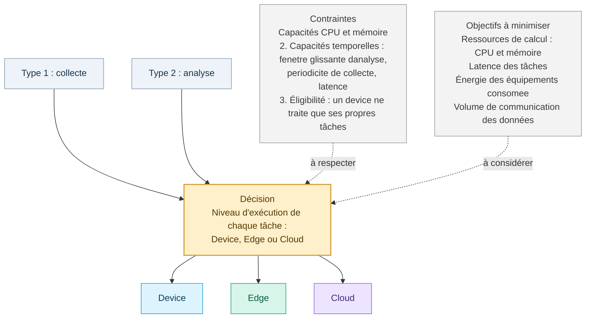

## AUTRE REPRÉSENTATION — trois zones, sans Mermaid

Une zone « **Décision** » au centre, une liste « **Contraintes** » à gauche et une liste « **Objectifs à minimiser** » à droite. Sous les trois zones, **« Objectifs en conflit : pas de solution unique, mais des compromis. »**

**Consignes designer — ne pas afficher :** Le schéma concerne les **deux types de tâches**, collecte et analyse, soumis au même choix de placement. Les **quatre items de la rubrique « Objectifs à minimiser »** et les **trois items de « Contraintes »** doivent rester dans ces rubriques comme sur le PPTX. Le PDF de proposition contient une modélisation plus large ; **ne pas injecter de matrice d’affectation chiffrée, de planification temporelle ni de fonction objectif symbolique**. Les fautes éventuelles du texte source sont conservées en attente de validation éditoriale.

---

# SLIDE 6 — TROIS MODES DE DÉCISION

**Référence :** PPTX A, slide 6.

## TEXTE À AFFICHER — COPIER TEL QUEL

**Trois modes de décision :**

**Hors ligne**
- Toutes les tâches sont connues à l'avance

**Par lots**
- Ré-optimisation à chaque fenêtre de temps

**En ligne**
- Placement dès l'arrivée de chaque tâche

## SCHÉMA MERMAID — trois frises conceptuelles

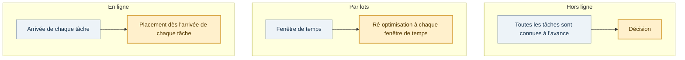

**Consignes designer — ne pas afficher :** Présenter **trois frises parallèles**. Garder exactement une phrase explicative par mode comme dans la slide d'origine. Pas de classement de performance entre les modes et pas d’association obligatoire de méthode de résolution à chaque mode : cette slide du PPTX ne le fait pas.

---

# SLIDE 7 — BENCHMARK : MÉTHODES, INSTANCES, MÉTRIQUES

**Source :** « Placement multicritère de tâches de supervision IoT.pptx », slide 7.  
**Statut :** contenu conservé, disposition libre.

## Texte à afficher — COPIER SANS CHANGER LES INFORMATIONS

**Benchmark : méthodes, instances, métriques**

**Méthodes**
- MILP : solutions de référence
- ε-contrainte : front exact
- NSGA-II : front approché
- Heuristiques gloutonnes

**Instances**
- Petites : méthodes exactes
- Grandes : NSGA-II
- Trace IoT réelle (NATE), adaptée à nos catégories de tâches

**Métriques**
- Ressources de calcul, latence, énergie consommée, volume de données transmis
- Contraintes CPU et mémoire; Contraintes temporelles
- Hypervolume de Pareto

**Résultats : [à compléter]**

## Schéma Mermaid — 3 colonnes, mêmes libellés que la source

```mermaid
flowchart LR
    subgraph M["MÉTHODES"]
        direction TB
        M1["MILP : solutions de référence"]
        M2["ε-contrainte : front exact"]
        M3["NSGA-II : front approché"]
        M4["Heuristiques gloutonnes"]
    end
    subgraph I["INSTANCES"]
        direction TB
        I1["Petites : méthodes exactes"]
        I2["Grandes : NSGA-II"]
        I3["Trace IoT réelle (NATE)<br/>adaptée à nos catégories de tâches"]
    end
    subgraph Q["MÉTRIQUES"]
        direction TB
        Q1["Ressources de calcul, latence,<br/>énergie consommée,<br/>volume de données transmis"]
        Q2["Contraintes CPU et mémoire ;<br/>contraintes temporelles"]
        Q3["Hypervolume de Pareto"]
    end
    M --> I --> Q
    classDef method fill:#FFF0CC,stroke:#D9A33B,color:#553800;
    classDef instance fill:#E8F3FA,stroke:#5E9CC4,color:#144667;
    classDef metric fill:#D8F5EA,stroke:#149E79,color:#075B45;
    class M1,M2,M3,M4 method;
    class I1,I2,I3 instance;
    class Q1,Q2,Q3 metric;
```

## Consigne de disposition — ne pas afficher

Trois panneaux de même largeur (« Méthodes », « Instances », « Métriques »). Sous les panneaux, une bande séparée conserve **exactement** « Résultats : [à compléter] ». Les flèches indiquent uniquement l'organisation du benchmark, **pas** un résultat algorithmique. Ne pas ajouter de chiffres ou d'axes de performance fictifs.

---

# SLIDE 8 — ÉTAT DE L'ART : COUVERTURE

**Source :** PPTX B (état de l’art), slide 1.  
**Statut :** contenu conservé, disposition libre.

## Texte à afficher — COPIER

**État de l’art**

**placement multi-objectif de tâches IoT en edge-cloud**

## Schéma Mermaid — illustration de l'intitulé uniquement

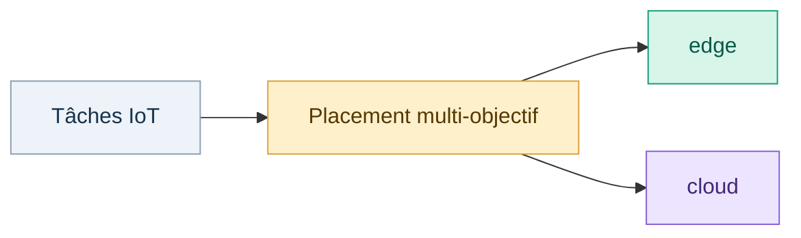

## Consigne de disposition — ne pas afficher

Slide de transition très sobre : titre large, sous-titre **strictement identique** à la source et schéma minimal dans le tiers inférieur. Ne pas ajouter d'auteurs ni d'affirmation sur la littérature à ce stade.

---

# SLIDE 9 — ÉTAT DE L'ART : TROIS FAMILLES DE MÉTHODES

**Source :** présentation de l'état de l'art, slide 2.

## Texte à afficher — COPIER SANS CHANGER

**Trois familles de méthodes**

**Optimisation mathématique**  
Garanties d’optimalité, mais taille limitée

**Méta-heuristiques**  
Passage à l’échelle, sans garantie

**Apprentissage**  
Adaptation en ligne, entraînement coûteux

## Schéma Mermaid — trois cartes équilibrées

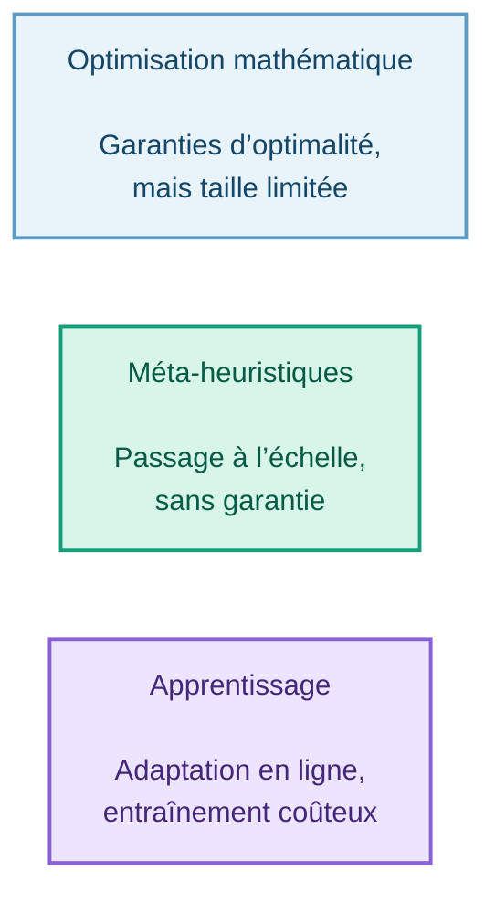

## Consigne de disposition — ne pas afficher

Mettre les trois cartes sur une seule ligne. Afficher les deux lignes de chaque carte comme **intitulé** et **limite/avantage**, sans inventer de score ni graduer les performances. Ne pas tracer de flèche entre les familles, qui ne forment pas une séquence de traitement.

---

# SLIDE 10 — ÉTAT DE L'ART : OPTIMISATION MATHÉMATIQUE

**Source :** présentation de l'état de l'art, slide 3.

## Texte à afficher — COPIER SANS CHANGER

**Optimisation mathématique**

| Article | Solution proposée | Limites |
|:--|:--|:--|
| MHeedra (Dollinger, Caillard et al., 2026) | MILP avec duplication de tâches (CPLEX) et version ACO | Exact limité à moins de 18 tâches ; ACO : 63,3 % d’optimaux ; délai seul |
| MILP en temps continu, edge–hub–cloud [titre à compléter] | MILP multi-objectif et multi-contraintes, duplication sélective | Comparé à une seule heuristique ; échelle limitée aux tailles visées |

*Contenus tirés des abstracts et extraits lus ; limites à confirmer dans les articles.*

## Schéma Mermaid — comparaison de deux articles (alternative au tableau)

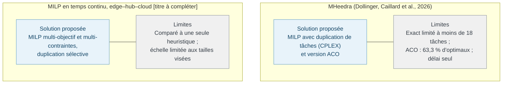

## Consigne de disposition — ne pas afficher

Deux lignes horizontales, une par article ; chaque ligne possède deux cellules « Solution proposée » et « Limites ». **Ne pas perdre le qualificatif 63,3 %, la borne moins de 18 tâches, le nom CPLEX, « délai seul », ni le titre [à compléter].** Ajouter la réserve originale en bas de page, en petit mais lisible. Le diagramme ne doit pas faire passer « limites » pour des résultats supplémentaires.

---

# SLIDE 11 — ÉTAT DE L'ART : MÉTA-HEURISTIQUES

**Source :** présentation de l'état de l'art, slide 4.

## Texte à afficher — COPIER SANS CHANGER

**Méta-heuristiques**

| Article | Solution proposée | Limites |
|:--|:--|:--|
| FFD-génétique parallèle, placement de services en fog | Énergie, gaspillage et latence ; 3 niveaux de priorité selon la deadline | Simulation ; fitness pondérée, pas de front de Pareto ; statique |
| Misha et al. (2025), MOMWTO | MOEA/D avec initialisation gloutonne (PIPK) et poids adaptatifs (WAPD), workflows DAG | Instances aléatoires ; pas de cloud ; énergie des appareils seulement |

*Contenus tirés des abstracts et extraits lus ; limites à confirmer dans les articles.*

## Schéma Mermaid — comparatif en deux bandes

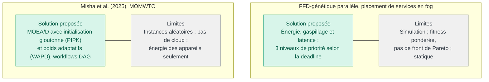

## Consigne de disposition — ne pas afficher

Gardez **deux articles et trois champs** (Article / Solution proposée / Limites), en cartes plutôt qu'en tableau si nécessaire. Préserver les sigles **MOEA/D, PIPK, WAPD, DAG** ainsi que « 3 niveaux de priorité selon la deadline ». Réserve identique en pied de slide.

---

# SLIDE 12 — ÉTAT DE L'ART : APPRENTISSAGE PAR RENFORCEMENT

**Source :** présentation de l'état de l'art, slide 5.

## Texte à afficher — COPIER SANS CHANGER

**Apprentissage par renforcement**

| Article | Solution proposée | Limites |
|:--|:--|:--|
| Haouari et al. (2024) | Pareto Q-learning (MDP) pour placer des tâches sur processeurs hétérogènes | 5 tâches, 3 processeurs ; hors ligne ; deux objectifs ; embarqué |
| Sravan & Shaik (2026) | DQN multi-objectif, poids adaptatifs, masquage d’actions | Simulation ; somme pondérée ; énergie edge seulement ; deadlines non garanties |

*Contenus tirés des abstracts et extraits lus ; limites à confirmer dans les articles.*

## Schéma Mermaid — deux cartes techniques, deux cellules chacune

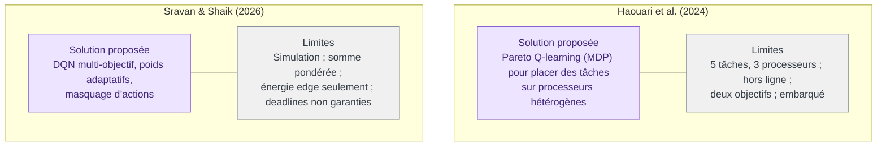

## Consigne de disposition — ne pas afficher

Une bande par article. Réserver assez de largeur aux **limites** pour que « 5 tâches, 3 processeurs », « deux objectifs », « embarqué », « deadlines non garanties » restent visibles. Maintenir exactement la réserve d'origine en bas.

---

# SLIDE 13 — ÉTAT DE L'ART : VERROUS ET POSITIONNEMENT

**Source :** présentation de l'état de l'art, slide 6.

## Texte à afficher — COPIER SANS CHANGER

**Verrous et positionnement**

**Un cas à la fois**  
Aucun article ne traite hors ligne, par lots et en ligne avec un même modèle

**Compromis fusionnés**  
Sommes pondérées fréquentes : un seul compromis, peu de fronts de Pareto

**Contextes simplifiés**  
Simulation, instances synthétiques, énergie côté edge seulement

**Notre approche : référence exacte (MILP, ε-contrainte) et NSGA-II sur les trois cas.**

## Schéma Mermaid — 3 verrous vers la proposition (textes de la source)

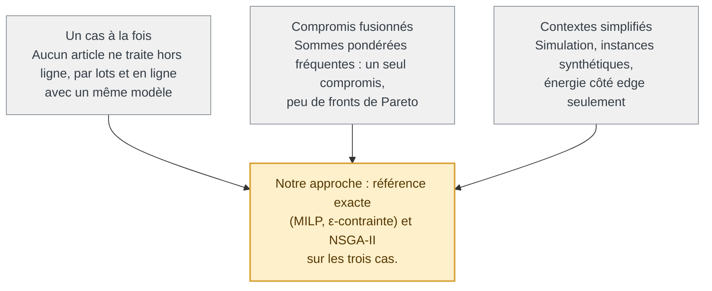

## Consigne de disposition — ne pas afficher

Trois blocs « verrous » de même taille au-dessus d'un **unique bandeau « Notre approche »**. Conserver la portée littérale de « Aucun article... » **sans en faire une affirmation nouvellement vérifiée** : il s'agit du contenu original de l'équipe. Ne pas ajouter de méthode ni de résultat.

---

# SLIDE 14 — ÉTAT DE L'ART : DONNÉES ET BENCHMARK

**Source :** présentation de l'état de l'art, slide 7.

## Texte à afficher — COPIER SANS CHANGER

**Données et benchmark**

**Base retenue : T-NATE**

- Trace IoT réelle d’Islamabad
- Edge : 1 passerelle qui reçoit toutes les tâches (calcul local)
- Fog : nœuds intermédiaires ; cloud : serveurs distants
- 8, 20 et 50 nœuds (50 : synthétique)

**Déjà disponible**
- Arrivées des tâches
- Deadline, cycles CPU, taille
- Capacités des nœuds
- Énergie

**À construire**
- Niveau device : routeurs, switchs, ESP32
- Catégories de tâches
- Périodicité et fenêtre d’analyse
- Mémoire
- Un équipement ne traite que ses tâches

**Écart avec notre modèle**

T-NATE : une seule passerelle edge reçoit tout, sans appareils IoT, et toute tâche peut aller sur n’importe quel nœud. Chez nous : device (calcul local, ses tâches seulement), edge, cloud.

Instances de tailles croissantes, plusieurs tirages par taille, mêmes instances pour les trois cas.

*D’après le README du dépôt ; colonnes exactes à vérifier dans les données.*

## Schéma Mermaid A — structure du benchmark et éléments à construire

```mermaid
flowchart LR
    subgraph BASE["Base retenue : T-NATE"]
        direction TB
        B1["Trace IoT réelle d’Islamabad"]
        B2["Edge : 1 passerelle qui reçoit<br/>toutes les tâches (calcul local)"]
        B3["Fog : nœuds intermédiaires ;<br/>cloud : serveurs distants"]
        B4["8, 20 et 50 nœuds<br/>(50 : synthétique)"]
    end
    subgraph DISPO["Déjà disponible"]
        direction TB
        D1["Arrivées des tâches"]
        D2["Deadline, cycles CPU, taille"]
        D3["Capacités des nœuds"]
        D4["Énergie"]
    end
    subgraph CONST["À construire"]
        direction TB
        C1["Niveau device : routeurs,<br/>switchs, ESP32"]
        C2["Catégories de tâches"]
        C3["Périodicité et fenêtre d’analyse"]
        C4["Mémoire"]
        C5["Un équipement ne traite<br/>que ses tâches"]
    end
    BASE --> DISPO --> CONST
    classDef basis fill:#E8F3FA,stroke:#5E9CC4,color:#144667;
    classDef available fill:#D8F5EA,stroke:#149E79,color:#075B45;
    classDef toBuild fill:#FFF0CC,stroke:#D9A33B,color:#553800;
    class B1,B2,B3,B4 basis;
    class D1,D2,D3,D4 available;
    class C1,C2,C3,C4,C5 toBuild;
```

## Schéma Mermaid B — écart avec notre modèle (reprend exactement les distinctions de la source)

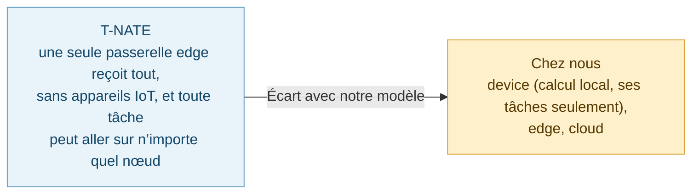

## Consigne de disposition — ne pas afficher

La slide d'origine est dense : garder **quatre zones** : (1) bandeau « Base retenue : T-NATE » et ses 4 caractéristiques, (2) « Déjà disponible », (3) « À construire », (4) « Écart avec notre modèle » en bas. Les deux diagrammes Mermaid sont **deux options**, non deux schémas obligatoires sur la même diapositive ; si la slide devient trop dense, préférer le B pour visualiser l'écart, et garder les deux listes textuelles en colonnes. Faire apparaître textuellement, sans réduction : « 8, 20 et 50 nœuds (50 : synthétique) », la phrase sur les instances de tailles croissantes et la réserve « D’après le README ... ».

---

# Contrôle qualité — NE PAS AFFICHER

- [ ] **14 slides** : slides 1–7 tirées du PPTX « Placement multicritère... » ; slides 8–14 tirées du PPTX « État de l’art... ».
- [ ] Les **6 premières slides reprennent les titres, listes, chiffres et réserves du PPTX A** ; elles ne sont plus réécrites d’après `Proposition_Projet_RO.pdf`.
- [ ] **Placement uniquement** : aucun Gantt, aucune gestion de précédence, aucun ordonnancement, aucune formule ou équation mathématique.
- [ ] Deux types de tâches seulement : **collecte** et **analyse** ; pipeline **Collecte → Analyse**, sans prétraitement autonome.
- [ ] Slide 14 « À construire » : **« Mémoire »** au lieu de « Mémoire et dépendances » (seule modification de périmètre dans benchmark / état de l’art).
- [ ] Slides 7 et 14 : conserver les contenus du benchmark séparément, avec « NATE » sur la slide 7 et « T-NATE » sur la slide 14.
- [ ] Slides 10–12 : deux articles par slide, trois champs « Article / Solution proposée / Limites », et la réserve originale en pied de page.
- [ ] Slide 7 : « Résultats : [à compléter] » ; slide 10 : « [titre à compléter] » et « 63,3 % d’optimaux » ; slide 14 : « 50 : synthétique » et « colonnes exactes à vérifier dans les données ».
- [ ] Les diagrammes Mermaid ne remplacent que la **disposition** du contenu ; tous les éléments textuels des PPTX restent visibles dans la slide finale.
- [ ] Aucun résultat expérimental, nombre ou performance ajouté de l’extérieur.

## Traçabilité — NE PAS AFFICHER

- `Placement multicritère de tâches de supervision IoT.pptx` : slides d’origine 1–7 → présent brief slides 1–7.
- PPTX B (état de l’art IoT edge-cloud) : slides d’origine 1–7 → présent brief slides 8–14.
- `Proposition_Projet_RO.pdf`, `Cours 1. modélisation.pdf`, `Cours 2.pdf` : uniquement pour la compréhension, pas pour écrire le texte des 14 slides.
